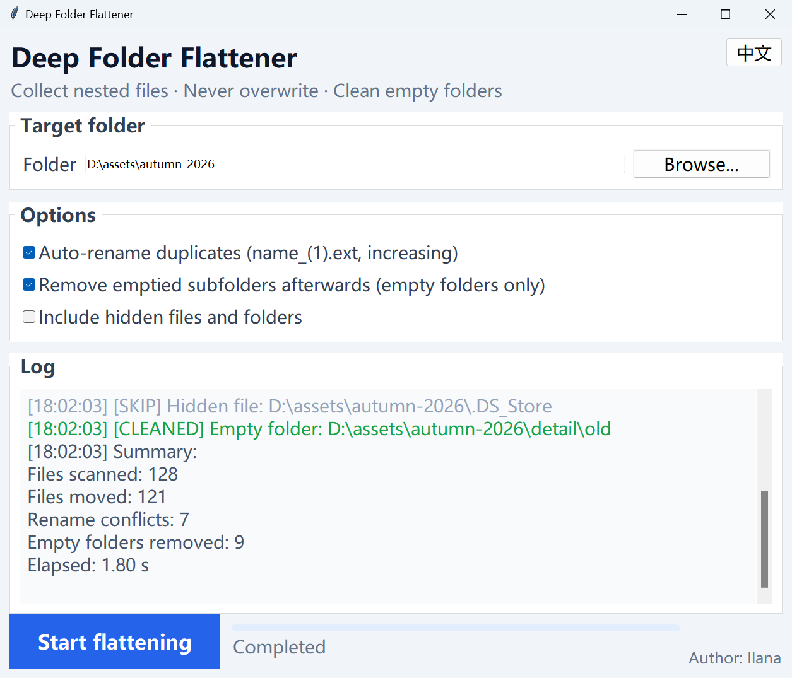

# 深层子文件夹文件一键提取平铺工具

[](LICENSE)
[](#环境要求)
[](#环境要求)

[English](README.md) | **简体中文**

一个 Windows 桌面小工具：把多层嵌套文件夹里的文件**一键剪切到根目录摊平**，重名自动改名不覆盖，顺手清理被掏空的子目录。

基于 Python 3 + tkinter，**仅使用标准库**，无第三方依赖、不联网。界面支持**中文 / English** 双语。

<p align="center">
  
</p>

| 中文界面 | English UI |
|---|---|
|  |  |

## 为什么需要它

素材包、下载目录、归档文件往往嵌套好几层（`素材包/主图/白底/01.jpg`）。手动收集意味着几十次剪切粘贴，而同名文件还会悄悄互相覆盖。这个工具一次性搞定，并且不覆盖任何原有文件。

## 功能

- **一键平铺**：递归遍历所有子文件夹，把文件剪切到所选根目录，保留原文件名与内容
- **重名保护**：冲突时自动命名为 `原名_(1).扩展名`、`_(2)`… 递增；Windows 下 `os.rename` 不会覆盖已存在的目标文件
- **空目录清理**：可选，仅删除确认为空的子目录（`os.rmdir` 对非空目录必然失败）
- **隐藏内容可选**：默认跳过隐藏文件/文件夹，可勾选处理（识别 Windows 隐藏属性与点开头文件）
- **拖拽导入**：从资源管理器把文件夹拖到窗口即可填入路径（Win32 `WM_DROPFILES`）
- **界面不卡顿**：遍历与移动在工作线程执行，日志经队列回传并按级别着色（成功 / 重名 / 跳过 / 异常）
- **异常隔离**：权限不足、文件被占用等问题记录日志后继续，不中断整体任务
- **高分屏适配**：启用 Per-Monitor V2 DPI 感知，布局与字号按 DPI 缩放
- **中英双语**：默认跟随 Windows 系统语言，标题栏右侧可随时切换

## 环境要求

| 项目 | 说明 |
|---|---|
| 系统 | Windows 10 / 11（64 位） |
| 运行 exe | 无需 Python、无需安装、无需联网 |
| 从源码运行 | Python 3.8+，tkinter（python.org 安装包自带） |

## 快速开始

从 [Releases](../../releases) 下载 `DeepFolderFlattener-v1.4.0.exe` 直接运行，或从源码启动：

```bash
python main.py
```

## 使用方式

1. 选择目标根文件夹：拖入窗口、点「浏览...」或直接输入路径
2. 按需勾选三个选项（默认：自动重命名开、清理空目录开、处理隐藏项关）
3. 点「开始一键平铺提取」，确认提示后等待完成
4. 查看日志与汇总（扫描数 / 提取数 / 重名数 / 清理目录数 / 跳过 / 异常 / 耗时）

程序会拒绝把磁盘根目录（如 `D:\`）作为目标，避免误整理整个磁盘。

> 移动操作不可撤销，执行前请备份重要数据，建议先用示例文件夹试跑一次。

## 技术实现

| 模块 | 说明 |
|---|---|
| UI | tkinter + ttk，自定义样式层与字号层级；窗口可缩放，初始尺寸按内容自适应 |
| 高分屏 | `SetProcessDpiAwarenessContext`（Per-Monitor V2）→ `SetProcessDpiAwareness` → `SetProcessDPIAware` 逐级降级 |
| 线程模型 | `threading.Thread` 执行遍历/移动，`queue.Queue` + `after()` 回传日志与统计，避免跨线程操作控件 |
| 拖放 | `DragAcceptFiles` + `SetWindowLongPtrW` 子类化窗口过程拦截 `WM_DROPFILES`，`DragQueryFileW` 读取 Unicode 路径，退出前还原窗口过程 |
| 防覆盖 | 目标存在则生成 `stem_(n).ext`；`os.rename` 在 Windows 上不覆盖已存在文件 |
| 进度条 | Canvas 自绘（圆角、品牌蓝、不定进度动画），避免系统主题强制使用绿色 |
| 图标 | 通过 PyInstaller `--add-data` 内嵌，运行时经 `sys._MEIPASS` 解析 |

## 目录结构

```
.
├── main.py               # 全部源码（单文件）
├── app_icon.ico          # 应用图标（多尺寸）
├── docs/
│   ├── icon.png
│   ├── screenshot-zh.png
│   └── screenshot-en.png
├── LICENSE
├── .gitignore
├── README.md
└── README.zh-CN.md
```

## 打包

```bash
pyinstaller --noconfirm --clean --onefile --windowed ^
  --icon app_icon.ico --add-data "app_icon.ico;." ^
  --name "DeepFolderFlattener" main.py
```

## 已知限制

- 仅支持 Windows；拖拽依赖 Win32 消息
- 不跟随符号链接/目录联接，避免越出目标根目录或循环遍历
- 移动操作无内置撤销，依赖用户备份
- 网络共享目录可用，但扫描速度取决于网络状况

## 版本记录

| 版本 | 变更 |
|---|---|
| v1.4.0 | 界面支持中英双语（标题栏可切换，默认跟随系统）；补充双语界面截图；采用 MIT 协议并公开仓库 |
| v1.3.0 | 新增文件夹拖拽导入；Canvas 自绘进度条（修复空闲残留绿块）；长路径从开头显示；字号层级与间距重排；窗口可缩放并自适应内容 |
| v1.2.0 | 补全交付文档、示例目录，稳定性修复 |
| v1.1.0 | 重名保护、空目录清理、隐藏项选项 |

## 许可证

[MIT](LICENSE) © 2026 Ilana

## 贡献

欢迎提交 Issue 反馈问题，或 Pull Request 改进功能。提交前请确保：

- 保持零第三方运行依赖（仅 Python 标准库）
- 改动集中在 `main.py`，并在 PR 描述中说明动机与测试方式
- 涉及文件移动的逻辑，请补充手动验证步骤（含重名、权限不足、隐藏文件等边界场景）
